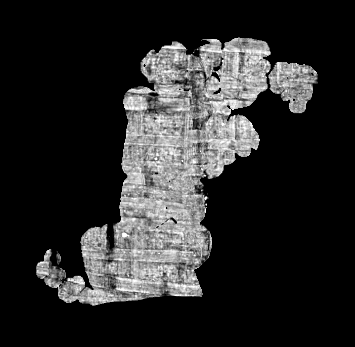
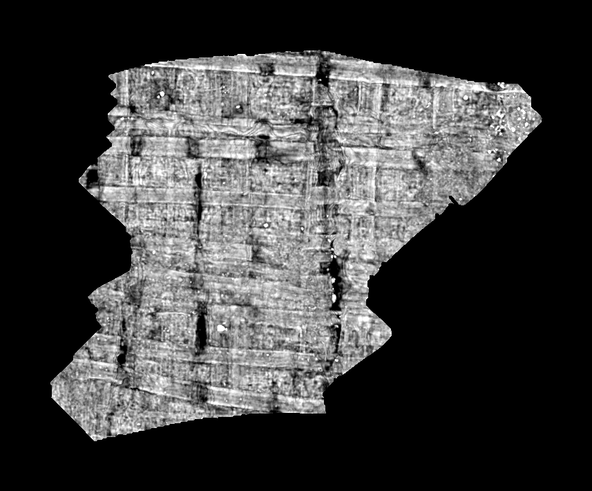

# Close-ups and fibre tools

A close-up is one region of an assembled sheet rebuilt as a single continuous,
isometric surface. Every chart near the region is an observation. The close-up
fits one fused surface through them, fills holes and borders, flattens it with
the scroll axis running down the rows, and renders the surface volume at one
pixel per voxel. It can then grow past its box into material the assembly left
out, and align its parameterization with the papyrus fibres.

These tools come from the development tree's October 2026 close-up chain:

| Executable | Purpose |
|---|---|
| `ink_closeup` | Build, grow, re-flatten, fibre-align and render a close-up. |
| `fiber_flatten` | Re-flatten a tifxyz canvas along a 3-D fibre field. |
| `closeup_strip_turn` | Turn a close-up rigidly onto its strip piece's frame. |
| `vmesh_fiber_rigid` | Rotate a whole sheet onto its measured fibre axes. |

```text
grid_pipeline ──> sheet_assemble ──> sheet_assemble --review ──> ink_closeup ──> surface volume
                   (chart store)                                  │               (any ink model)
                                                                  ├─ grow: pool + F0 bridge
                                                                  └─ fibres: --measure-fibers,
                                                                     --reparameterize, fiber_flatten
                                                                     + --reuv, vmesh_fiber_rigid
```

Close-ups read the outputs of [`sheet_assemble`](SHEET_ASSEMBLY.md). Ink
detection is not part of this repository; the rendered layers are the input an
ink model expects.

## Inputs

- **A layout.** This is a directory holding `stage6_repaired.vmesh`,
  `stage6_repaired_chart.i32` and `sheet_index.json`. Run `sheet_assemble
  --review` into the assembly's own output directory to add the index:

  ```powershell
  sheet_assemble --review output\sheet\stage6_progress.asr output\sheet configs\axis.csv
  ```

- **RAW CT.** `cubes_RAW/` TIFFs or an uncompressed `uint8` Zarr v2 group
  (level `0`, 128³ chunks, `/` chunk keys). Fibre measurement from the CT reads
  the Zarr form only.
- **The axis table**, as for the assembly.
- **Optional:** a chart pool for growth, F0 prediction cubes for the F0
  bridge, and a fibre field (see [Fibre field](#fibre-field)).

## A close-up

The configuration is a JSON file. Tuning lives in the `CLOSEUP_*` constants of
`src/common/pipeline_constants.h`, not on the command line.

```json
{
  "id": "r65",
  "out_dir": "output/closeups/r65",
  "layout": "output/sheet",
  "raw": "PHerc0139-4x5x5/cubes_RAW",
  "axis": "configs/axis.csv",
  "voxel_um": 9.362,
  "seed_box": [-3600, -100, -3200, 250],
  "grow_px": 64
}
```

```powershell
ink_closeup output\closeups\r65.json [--stop-after surface|render]
```

| Key | Meaning |
|---|---|
| `id`, `out_dir` | Every output is `<out_dir>/<id>_*`. |
| `layout`, `raw`, `axis` | The inputs above. |
| `voxel_um` | Scan pitch; reports and scale bars only. Required. |
| `seed_box` | `[x0, y0, x1, y1]` on the layout's sheet grid (its UV, 1 px per voxel). The pieces that own it seed the close-up. |
| `grow_px` | The close-up takes the seed pieces' faces within this margin of the box. |
| `complete_gaps` | Optional wider fill of segmentation gaps, with observed and fitted provenance kept apart. |
| `seed_all_pieces` | Optional: keep small pieces beside large ones in a whole-region request. |
| `z_top_to_bottom` | Default `true`: increasing z runs down the rows. Set `false` for scans whose z runs from the scroll's bottom to its top, or the letters read upside down. |

Stages, each resumable from its files:

- **surface.** Charts within the grown box become observations in one frame.
  Nodes every 2 px take a robust local quadric fit, so the 1–3 voxel steps
  between charts become one surface and a stray observation from another wrap
  gets no weight. Holes and borders are filled up to `CLOSEUP_FILL_PX`. The
  fused surface is flattened isometrically (SLIM with a scaffold) and turned so
  the axial coordinate runs down the rows. Writes `<id>_surface.vmesh` with
  normals (`_nrm.f32`), data/fill labels (`_attr.u8`), source charts
  (`_chart.i32`) and `<id>_surface_report.json`.
- **render.** The surface volume at 1 px per voxel: 21 layers inward
  (`<id>_layers.zarr`, `<id>_layers_mask.tif`), the geometry volume, a CT bake
  (`<id>_ct.tif`/`.png`), a provenance map and `<id>_render_report.json`.

`--render-rect`, `--render-sweep` (a deeper depth sweep), `--reflatten` (a
growth's last steps again) and `--letters` (letter boxes and rows on an ink
map) reuse a finished surface.

## Growing a close-up

A close-up's box is a starting point, not a crop. Growth reads charts from one
or more **pools** and adopts those that continue the surface:

```powershell
ink_closeup --pool-from-store output\sheet\charts output\closeups\pool
```

This turns the assembler's stage-1 chart store into a pool. Every chart the
assembler keeps for layout is included, so material outside any assembled
region becomes adoptable without an assembly. Then point a configuration at
the finished close-up:

```json
{
  "id": "r65g",
  "surface_source": "output/closeups/r65/r65",
  "growth_uv": [-700, -700, 1400, 1400],
  "pool": ["output/closeups/pool"],
  "grow": {"f0": ["PHerc0139-4x5x5/cubes_PRED"]}
}
```

(with the other keys as before). `surface_source` is the close-up's stem, and
`growth_uv` the target box in its frame. Each read takes only the pool charts
near the data boundary, so memory follows the boundary rather than the target
box. Adoption is a rigid fit of each chart's contacts, gated by continuity,
metric, normal and layer checks. Growth stops when a read places nothing, when
progress stalls (`min_gain`), or after `max_reads`.

Where no chart crosses a gap, the **F0 bridge** follows the prediction instead.
It grows ring by ring from the surface and snaps each new node to the
probability ridge nearest its prediction, so a bridge stays on the sheet it
started from. Duplicate-layer and ambiguity guards stop it at merged bands.
`grow` also accepts `margin_vox`, `rounds`, `max_reads`, `reflatten`,
`f0_depth_px`, `f0_rings` and `f0_passes`.

## Fibre alignment

Readable pages need the fibres along the page axes. Close-ups measure fibres
physically and align the parameterization to them, without moving any 3-D
geometry.

- `ink_closeup <config> --measure-fibers` measures fibre directions on every
  face of `surface_source`. It works from the CT's fibre cross on tangent
  patches. With `fiber_volume` set it reads an inferred 3-D fibre field
  instead. It writes `<id>_surface_fiber_arms.f64` and
  `<id>_fiber_measure.json`.
- `ink_closeup <config> --reparameterize` re-flattens `surface_source`. With
  `"fiber_constraints": true` it aligns to the measured fibres. A checked SLIM
  warm start is followed by angular local/global least squares (TAUCS global
  steps, ADMM constraints). The objective is symmetric Dirichlet energy plus
  the angular fibre loss. Originally valid faces keep their metric bounds, and
  every material contact is audited. `--reparameterize-conformal` and
  `--reparameterize-cuts` (cone cuts to the border) are variants. The report
  states whether the RMS fibre target (10°) was reached, the loss converged,
  the work ran out, or no safe step remained. Exit 1 means the result did not
  qualify (a material contact, too little measured area, or the RMS still
  above the target); its files are still written for review.
- `vmesh_fiber_rigid input.vmesh arms.f64 output.vmesh report.json` fits one
  rotation to a whole sheet from those measurements: an exact sweep, no
  iterative solve. XYZ, faces and vertex identities are unchanged, and missing
  evidence is never counted as alignment. See its `--selftest`.
- `fiber_flatten job.json` re-flattens a tifxyz canvas along a fibre field.
  The job names `seg` (the tifxyz), `fibers` (the field), `out`, and
  optionally `rect` and `uuid`. It writes the re-flattened tifxyz, the forward
  map (`fiber_map_u.tif`, `fiber_map_v.tif`), a fibre profile and an audit.
  Export the close-up with `vmesh_tifxyz <id>_surface.vmesh <dir> --canvas
  --native-grid`, which writes one tifxyz, `<dir>/piece_p000`, at one sample
  per voxel. Then carry the surface into the fibre frame with
  `ink_closeup <config> --reuv <fiber_flatten out dir>`. Every vertex goes
  through the map and 3-D stays unchanged. A completion pass in that frame
  (`complete_gaps`) finishes it.
- `closeup_strip_turn job.json` fits the 2-D rotation that carries a close-up's
  canvas onto its strip piece from 3-D matches (`matches`: float64 `col, row,
  x, y` rows). It writes the same map contract, for `--reuv`. A reflection is
  written as a turn plus a named flip. Too few matches, or a residual above
  `STRIP_TURN_MAX_RESIDUAL` × their spread, is refused with exit 3.

### Fibre field

`fiber_flatten`, and `fiber_volume` in close-ups, read an uncompressed `uint8`
Zarr group with three arrays, `presence/`, `nx/` and `ny/`, each on the scan's
grid with 128³ chunks (level `0`, `/` chunk keys). Values are `presence =
round(255 p)`, `nx = round(127 d_x + 128)` and `ny = round(127 d_y + 128)` for
the unit fibre direction `d`, folded to `d_z ≥ 0`. This is the encoding of the
scroll prize's published fibre fields. `fiber_volume` also expects an
`inference_identity.json` at the field's root, copied into the outputs as
provenance. The development tree produces fields with villa's 3-D fibre model
(`scrollprize/lasagna-fiber`); that inference is not part of this repository.

## Example: PHerc0139 4×5×5

From the 100-cube reference assembly (`sheet_assemble` with
`configs/default.json`, run through `audit`), with the configurations above:

| | Close-up | Grown |
|---|---|---|
| Surface | 32,809 vertices, 62,197 faces | 61,499 vertices, 121,990 faces |
| Render | 702 × 686 px: 57,526 observed, 67,379 filled | 857 × 710 px: 55,835 observed, 184,728 adopted |
| Work | 9 s | 6 reads, 16 charts adopted, 42,220 nodes on the F0 ridge, 38 s |





The growth stopped when a read placed nothing more. Its data nodes rose from
15,092 to 59,391 (5.4% of the 3× target box).

## Verification

- Every tool has a `--selftest`, and `ctest` runs them: SLIM, local/global
  and fibre-map solves, growth, the F0 bridge, the re-UV, reparameterization,
  rigid turns, material contacts and the fibre measurements.
  `ink_closeup --material-contact-selftest` checks the contact walk.
- `ink_closeup` here is the development tree's engine of record
  (`ink_closeup_20261028_main_cebf7654`). On the record's hard qualification
  replay (a 9,608-vertex PHerc0358 close-up, `--reparameterize` against an
  inferred fibre field, one thread), all eight output files are byte-identical
  to the record's: the mesh, fibre arms, normals, labels, charts, material
  identities, inference identity and component log. The report matches apart
  from timings and paths. The fibre RMS is 10.124408°, which is still above
  the 10° target, as the record's is, so both exit 1.
- `fiber_flatten` is the development tree's main line (25 October), which the
  close-up engine also uses. It is not byte-identical to the older 16 October
  `fiber_flatten` engine. On one real close-up job the two give equivalent
  alignments: the residual fibre climb is 18.2 px against 20.3 px, with 97
  folded nodes against 105.
